# Architecture and ML methodology

```mermaid
flowchart LR
    S[Authorized CSV or synthetic generator] --> V[Schema and mature-label validation]
    V --> T[Temporal split with maturity embargo]
    T --> C[Training-only temporal CV and preprocessing]
    C --> M[Logistic / Random Forest / Histogram Boosting]
    M --> K[Training-fold sigmoid and isotonic calibration]
    K --> Q[Validation calibration and review threshold selection]
    Q --> E[Frozen out-of-time evaluation]
    E --> A[Immutable candidate model and manifest]
    A --> G[Independent validation and governance approval]
    G --> P[Trusted deployment digest]
    P --> API[FastAPI scoring]
    API --> H[Human credit-risk review]
    API --> O[Aggregate telemetry]
    O --> I[Investigation and controlled retraining]
    I --> S
```

One Python package has separate modules for contracts, data, features, training,
evaluation, explainability, artifact lifecycle, inference, monitoring and HTTP handling.
There is no training call in the API. A complete sklearn pipeline retains column order,
feature engineering, imputation, encoding and estimation across training and serving.
A file-based registry is sufficient for this single-service implementation; MLflow,
distributed infrastructure, a database and a separate Java service are not justified yet.

Logistic regression is a regularized baseline with scaling. Random Forest uses bootstrap
aggregation (bagging), nonlinear trees and random feature subsets. Histogram gradient
boosting fits trees sequentially to improve loss. Each has a bounded randomized search,
class-weight alternatives and the same temporal folds and negative-Brier search score.
The RF search covers tree count, depth, split/leaf sizes, features, weights and max_samples.
Single-process numerical execution bounds compute and aids reproducibility.

Calibration compares uncalibrated, sigmoid and isotonic validation Brier scores. Both
calibrators use expanding, maturity-purged training folds; the selected calibrated model
averages those fitted fold models. It does not refit on validation or test data. Tuning
and calibration reuse training folds, so CV scores are selection diagnostics rather than
unbiased performance estimates. Validation is used for method/threshold selection and is
also not an unbiased final estimate. The untouched out-of-time test supplies final evidence.
Random Forest remains the requested primary artifact even if a challenger performs better.
A new model-family promotion needs a separately reviewed experiment; no test-driven switch.
No voting/stacking layer is added without demonstrated validation improvement.

Reports include ROC-AUC, average precision (PR summary), precision, recall, F1, balanced
accuracy, confusion matrix, Brier score, log loss, ROC/PR/calibration curves, compressed
model size, and batch wall-clock milliseconds per row. Latency is a local observation,
not an SLA or concurrent load benchmark. Bootstrap 95% intervals assume independent rows;
the synthetic cohort has unique borrowers. Real repeated-borrower/time-series data needs
cluster/block bootstrap, which is not implemented. Model byte hashes are not guaranteed
identical across OS/Python builds; prediction reproducibility is tested in one environment.

Review thresholds minimize validation average cost under a validation review-rate cap.
Cost = FN × default-loss + FP × unnecessary-alert-cost + alerts × review-cost.
This stylized objective implicitly values finding a default at the full FN cost; actual
review efficacy, recoveries and exposure-weighted loss are not modeled. Costs and capacity
are configurable; 0.5×/1×/2× FN cost sensitivity is reported. Fixed thresholds may exceed
capacity when populations change; an authorized separate queue policy is required.
No review threshold or credit decision is applied by the scoring API. Risk bands are
explicitly provisional display categories and separate from the review policy.

Global importance includes RF impurity rankings over transformed columns and repeated
permutation rankings over original columns on validation, scored by Brier degradation.
Different feature spaces and correlated ratios prevent one-to-one rank interpretation.
Five shuffle repeats measure permutation variability, not temporal stability or confidence
in causal effects. Continuous/high-cardinality impurity bias and correlated-feature
substitution remain. Local reference replacement recomputes all engineered features via
the pipeline and reports changes in calibrated PD relative to training medians/modes.
It is not additive, can be off-manifold and does not implement SHAP. It fails explicitly
for anything other than one ordered record. Customer-facing reason codes need independent
legal and model-risk validation.
