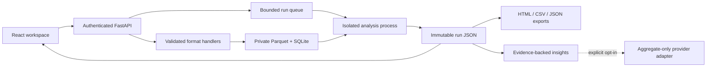

# Architecture and operations

## Boundaries

- `backend/eda/ingestion.py`: content validation, workbook inspection, original-value preserving import, dimensions and decompression limits.
- `backend/eda/analytics.py`: deterministic semantic inference, profiles, filtering, statistics, chart aggregation, correlations, categorical associations, outliers and evidence rules.
- `backend/eda/models.py`: validated request contracts, bounded filters and analytical controls.
- `backend/eda/service.py`: SQLite metadata, UUID-only paths, isolated worker processes, durable run state and artifacts.
- `backend/eda/security.py`: pre-multipart authenticated, bounded request buffering with concurrency and receive timeouts.
- `backend/eda/api.py`: authenticated HTTP orchestration, ownership checks, errors and exports.
- `backend/eda/llm.py`: optional aggregate-only provider adapter with structured output validation and deterministic fallback.
- `backend/eda/reports.py`: escaped standalone reports.
- `frontend/src/`: React workspace, typed contracts, chart lifecycle and responsive styles.

React/TypeScript and Plotly provide the UI. FastAPI owns the API and serves built assets. Polars handles columnar data; NumPy/SciPy provide statistics. SQLite with WAL and a private local volume is a deliberate single-node simplification rather than introducing PostgreSQL without a distributed workload. Redis, Kafka and independent services are unnecessary for this bounded deployment. No runtime CDN or external font dependency is required.

## Persistence and consistency

A dataset UUID identifies an immutable stored Parquet file. Its fingerprint hashes upload bytes plus parsing options. A new UUID analysis run stores parameters, filters, algorithm version, timestamp, state and output. Exports read that run artifact. Exact computation is rerun rather than cached; no stale cache or cross-owner cache is possible.

Schema version 1 is created by startup migration (`PRAGMA user_version`). There is no external migration command for version 1. Future upgrades must introduce explicit forward migrations; do not use startup table creation as a substitute for a schema migration. Back up the SQLite database through SQLite backup tooling plus the corresponding Parquet/JSON artifacts while the service is quiesced. Test restores before relying on backups.

Files use generated UUID names, never supplied paths. Metadata stores a SHA-256 digest of the access token as the owner identifier, not the token itself. Changing a token changes the owner: ownership-preserving rotation and account management require an identity system extension.

## Jobs

One API process owns two coordinating threads and at most two active child processes. Six slots bound running plus queued work. Jobs persist as queued/running/completed/failed/cancelled. The supervisor terminates jobs exceeding the timeout. Cancellation terminates active work and cleans incomplete artifacts. After server restart, interrupted jobs become failed with a resubmission message. No automatic retries are used for deterministic analytical errors. External AI errors fall back immediately.

Queue capacity is global, not per tenant. This is unsuitable for adversarial multi-tenant fairness requirements. Never start multiple Uvicorn workers or replicas against this job manager. Host/container memory bounds remain required: Python process isolation alone is not a memory sandbox.

## Security

No authentication fallback is enabled in production. Every dataset, job, result and download checks ownership. Same-origin deployment has no permissive CORS middleware. Tokens are held in browser memory and sent as Bearer headers. Request bodies are authenticated before parsing, capped even without Content-Length, concurrency-limited and timed out. Authenticated requests are bounded to 120/minute per token in-process.

Uploaded CSV, ZIP/XML workbooks and Parquet are untrusted. Invalid structures, duplicate or missing headers, nested/binary Parquet, macros and oversized dimensions are rejected. Workbook expansion is capped at 100 MiB and 2000 entries. Spreadsheet formulas are stored as text and never evaluated. CSV exports escape formula prefixes. HTML reports escape all user content and use a restrictive report CSP. React renders labels as text. The deployment directory must remain private; disk encryption, TLS termination, secret rotation and host patching remain operator responsibilities.

Logs contain generated request IDs, analysis IDs, status and duration, not rows or credentials. OpenAPI examples contain no user data. Access logging is disabled in documented commands to avoid accidental sensitive query logging. Health and readiness reveal only service status.

Retention cleanup runs at startup, default 30 days. For a strict deletion SLA, restart on a scheduled maintenance interval or add a coordinated periodic maintenance task. User deletion removes dataset and all associated artifacts after jobs stop. Backups require their own retention policy.

## External AI

Default findings are deterministic and versioned with the analytical engine. Optional explanations require explicit server opt-in, a model, HTTPS endpoint and server credential. Only insight IDs, rule types and aggregate metric evidence are submitted; no column labels, categories, filenames or raw rows. The adapter bounds output tokens and time, validates schema and evidence IDs, and falls back on errors. LLM prose is clearly labelled unverified interpretation: schema validation cannot guarantee factual correctness. It never executes instructions or tools. Providers must be vetted separately for data processing requirements.

## Limitations

- Single node, local storage and token-based ownership; no PostgreSQL, S3, SSO/RBAC, horizontal workers, per-owner storage quota or distributed rate limiter.
- Ingestion is bounded but occurs in API worker threads; use container memory limits and trusted workloads. Hostile compressed Parquet can still pressure memory during materialization.
- The frontend currently has a large Plotly bundle. It is functional but initial load optimization remains worthwhile.
- Preview supports server-side pages of 50 rows; missingness shows first 200; outlier investigation first 200. Full counts are exact and truncation is labelled.
- Workbook sheet selection is available by name; first import lists available sheets for subsequent imports. No pre-upload workbook picker.
- Temporal cadence, seasonality, forecasting, mixed categorical/numeric comparisons and multivariate anomalies are not implemented.
- ISO date range filtering and selection of up to 20 numeric correlation columns are supported.
- Reports support HTML/JSON/CSV and chart PNG, not server-generated PDF. HTML sections are configurable; full flagged records can be exported per numeric column.
- No model-based inference is claimed: the default AI-assisted layer is evidence-backed deterministic rules.
- No automated full accessibility audit, load/chaos testing, container deployment certification, or live-provider validation has been completed unless explicitly recorded in verification notes.

## Request flow

