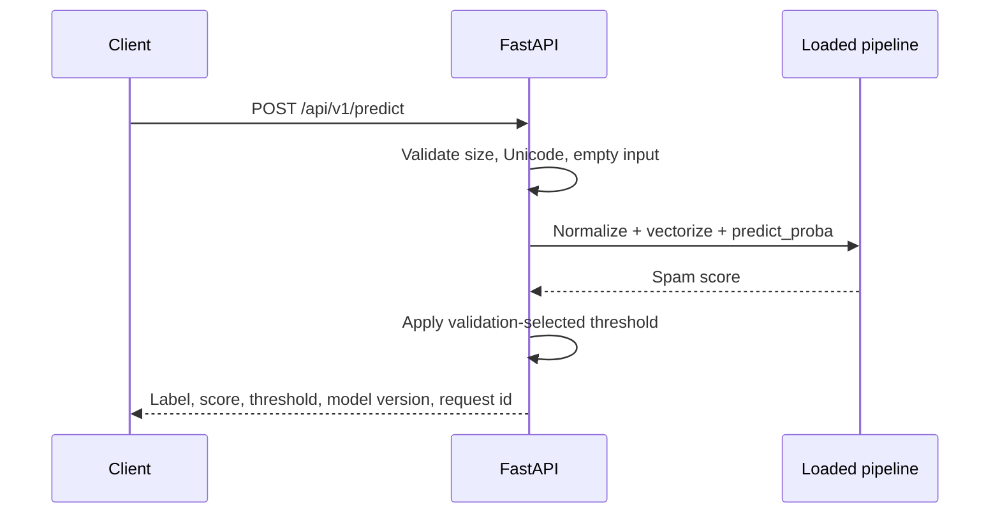

# Email Spam Detection System

A focused, leakage-aware email classifier built around Bag-of-Words and scikit-learn's Multinomial Naive Bayes. It exposes a versioned FastAPI inference service and keeps training offline.

The included fixture is for software verification only. It is intentionally small and must not be used as evidence of production accuracy.

## Architecture

```mermaid
flowchart LR
  D[CSV / EML adapter] --> V[Validation and profiling]
  V --> S[Leakage-aware split]
  S --> P[Shared Unicode/HTML/text normalization]
  P --> B[CountVectorizer BoW]
  B --> N[Multinomial Naive Bayes]
  N --> T[Validation threshold]
  T --> A[Checksummed model artifact]
  A --> API[FastAPI inference]
  API --> R[SPAM/HAM + score + indicators]
```





## Mathematics

Bayes' theorem is `P(C|X) = P(X|C)P(C)/P(X)`. For example, suppose 40% of training emails are spam, `P(free|spam)=0.30`, and `P(free|ham)=0.01`. Ignoring other words, the unnormalized posteriors are `0.30×0.40=0.12` and `0.01×0.60=0.006`; after normalization the spam posterior is `0.12/(0.126)≈0.952`.

Conditional probability is `P(A|B)=P(A∩B)/P(B)`: `P(free|spam)` counts spam messages containing `free` divided by all spam messages. Multinomial Naive Bayes assumes token counts are conditionally independent given a class and computes:

`log P(C|X) ∝ log P(C) + Σ x_i log P(w_i|C)`

With additive smoothing, `P(w_i|C)=(N_i,C+α)/(ΣN_j,C+α|V|)`. Logs prevent underflow; the model's independence assumption is useful but imperfect. The reference implementation in `src/spam_detection/reference_nb.py` is educational and tested separately from production inference.

## Dataset

The supported CSV schema is `text,label`, with labels `spam` and `ham`. `subject,body,label` is also accepted. `load_dataset` normalizes Unicode, strips HTML with the standard library parser, replaces URLs and addresses with stable markers, validates labels, rejects empty records, fingerprints the dataset, and reports exact/template duplicate candidates.

For real evaluation, obtain a licensed corpus such as the Apache SpamAssassin public corpus from its official distribution and record the downloaded version, license, source hash, and any permitted preprocessing in your experiment notes. Do not commit the corpus or private mail. Raw `.eml` parsing is available through `parse_eml`; attachments are never executed.

## Setup and commands

```bash
python3.12 -m venv .venv
source .venv/bin/activate
python -m pip install -e '.[dev]'

# Software-verification workflow only
spam-detection train --data data/fixtures/toy_emails.csv
spam-detection evaluate --data data/fixtures/toy_emails.csv --artifact artifacts/model.joblib
pytest -q
ruff check src tests
mypy src

# Start the API after training
uvicorn spam_detection.api:app --host 127.0.0.1 --port 8000
```

The training command creates `model.joblib`, a JSON metadata manifest, a SHA-256 sidecar, and an evaluation JSON report. The final test split is held out while the threshold is selected on validation data. For a real corpus, pass a separate untouched test file to `evaluate` rather than evaluating the training input.

## API

```bash
curl -X POST http://127.0.0.1:8000/api/v1/predict \
  -H 'content-type: application/json' \
  -d '{"subject":"Congratulations!","body":"You have won a free prize. Claim it now."}'
```

Responses contain `label`, the raw model `spam_score`, threshold, model version, request ID, and token contribution indicators. The score is deliberately described as a model score, not a calibrated probability, until calibration has been established on representative data. Health endpoints are `/health/live` and `/health/ready`; model metadata is `/api/v1/model/info`; metrics are at `/metrics`.

Authentication, rate limiting, and TLS should be enforced at the trusted deployment boundary for public exposure. The baseline does not irrevocably delete mail: use quarantine/review and human feedback until false-positive behavior is validated.

## Security and operations

Joblib/pickle loading is a trust boundary: only load artifacts from a controlled store and verify the SHA-256 sidecar. Deploy the provided container as non-root with a read-only filesystem. Do not log email bodies or explanation tokens in routine logs. Add dependency/container scanning in the deployment platform, externalize secrets, and define retention/access controls for any labeled feedback.

Threats include obfuscated spam, poisoned training data, duplicate/template leakage, distribution shift, model extraction, and maliciously oversized or malformed MIME/HTML. This classifier is not an attachment scanner, malware detector, or complete phishing defense. Monitor request rate/errors/latency, score distribution, model version, and—when trustworthy labels arrive—false positives, false negatives, drift, and calibration. P50/P95/P99 latency must be measured from production traffic; it is not claimed here.

## Limitations and rollback

The baseline uses word counts and a conditional-independence model. It can miss intent, multilingual content, adversarial spelling, and thread/context relationships. Thresholds are business decisions: tune against a representative validation set with an explicit false-positive budget, then confirm on an untouched test set with uncertainty and class counts. Promote artifacts atomically, keep the previous checksummed artifact, and rollback by restoring the prior `SPAM_MODEL_PATH` through a controlled deployment.
