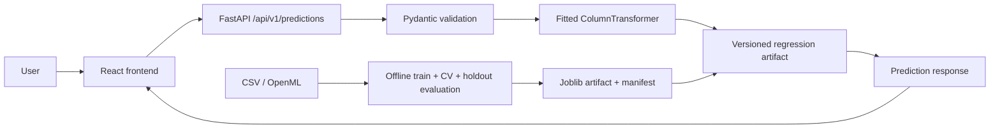

# Architecture

The runtime loads one trusted artifact at startup. Training is an offline process and never runs in a request. Numeric imputation/scaling and categorical imputation/one-hot encoding are fitted inside the estimator pipeline, including within CV folds. The fixture makes CI self-contained; the acquisition script supports a public Ames CSV.
